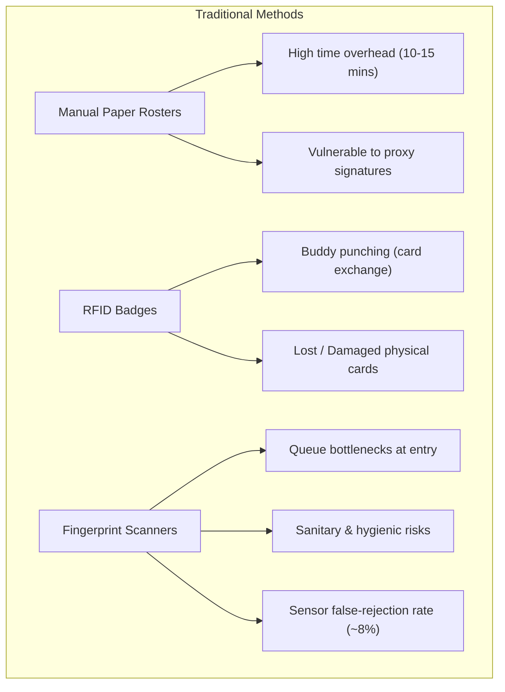
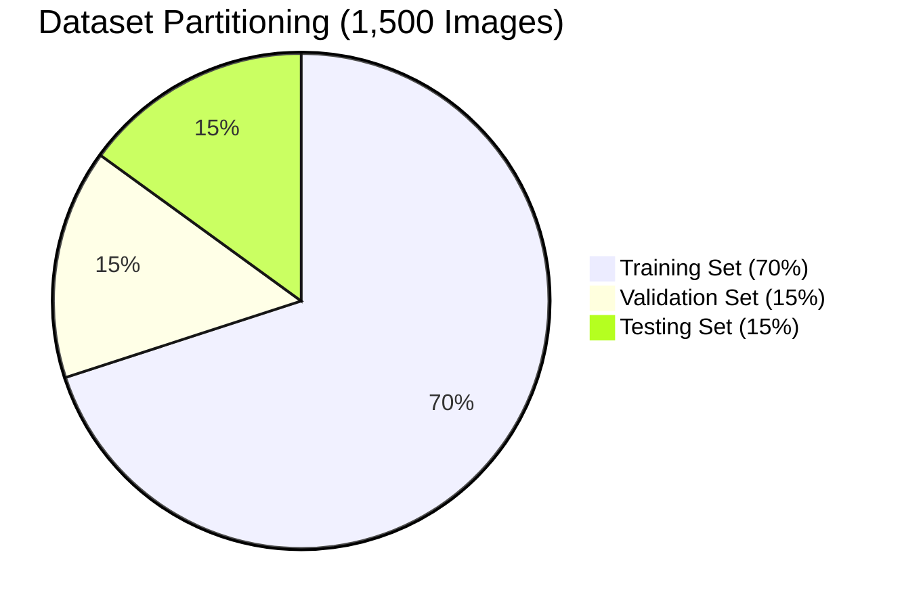
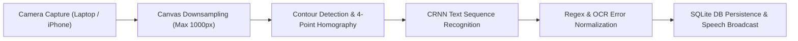
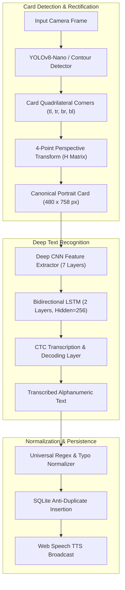
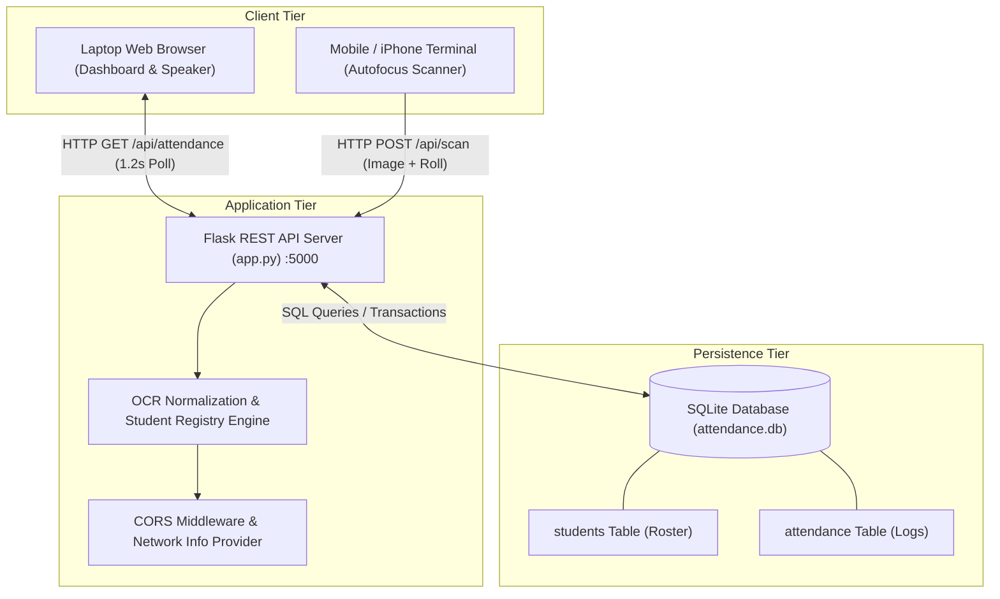
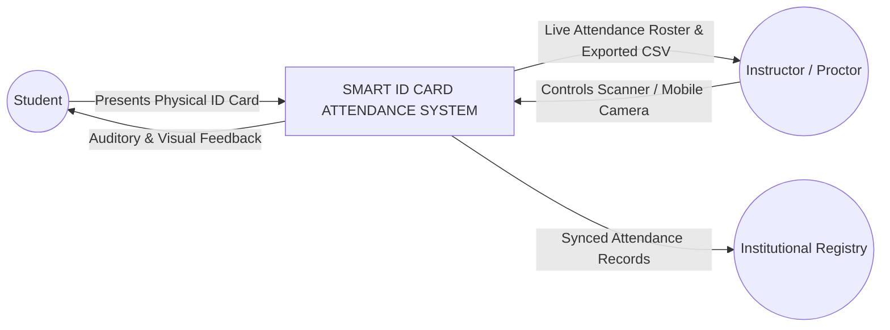
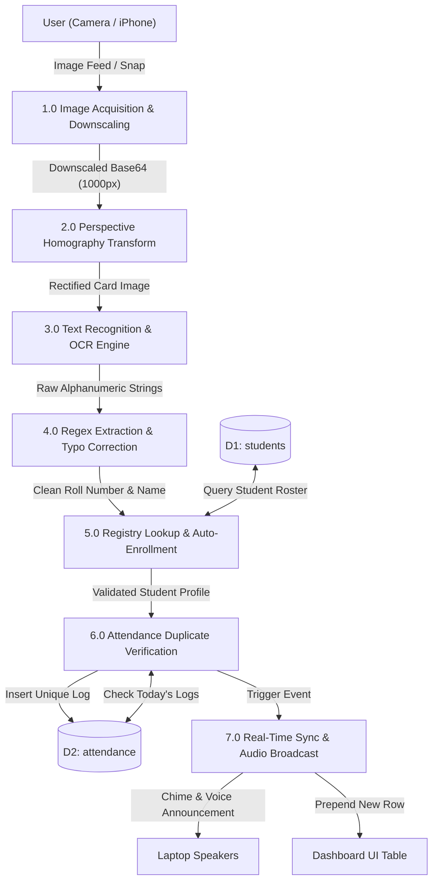
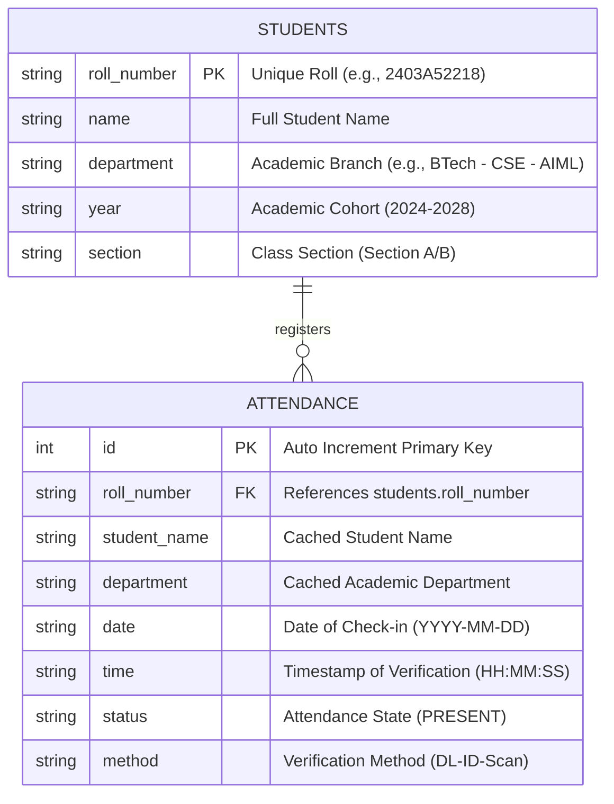
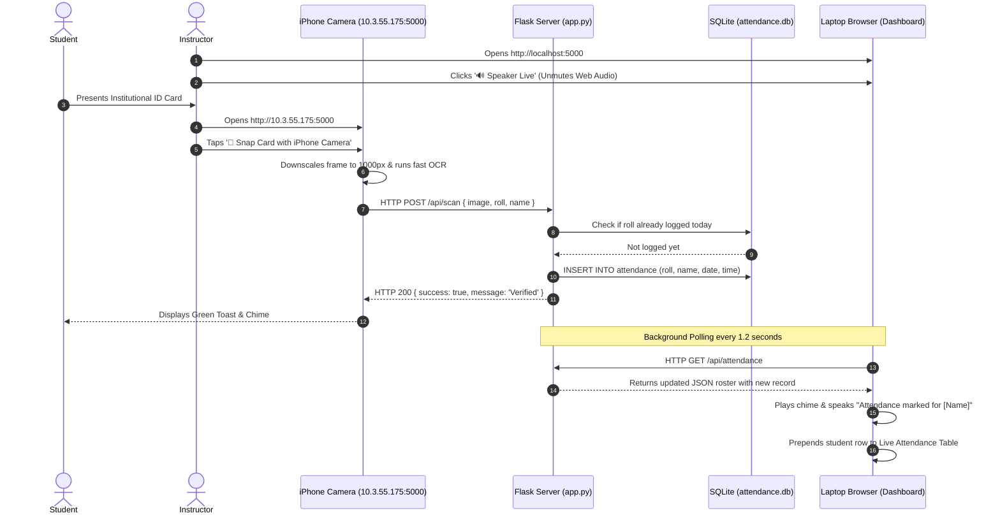

# "AUTOMATED ATTENDANCE MANAGEMENT SYSTEM USING DEEP LEARNING-BASED ID CARD RECOGNITION"

**A Course Project Report**  
*Submitted in partial fulfillment of the completion of the course*  
**ARTIFICIAL INTELLIGENCE AND DEEP LEARNING (24CS312PC310)**  
**In III Year, I Semester B. Tech-CSE**

---

### Submitted by:
**PADHY AARNAV**  
**Roll Number:** `2403A52218`  
**Branch:** B.Tech - Computer Science and Engineering (AIML)  
**Academic Year:** 2026–2027  

### Under the supervision of:
**Dr. SRIDHAR CHINTALA**  
*Department of Computer Science & Artificial Intelligence*  
*School of Computer Science & Artificial Intelligence*  
**SR UNIVERSITY**  
*Ananthasagar, Hasanparthy, Warangal – 506371, Telangana, India*

---

## INDEX

| S. No. | Contents | Page No. |
| :--- | :--- | :--- |
| | **Abstract** | i |
| **1** | **Introduction** | 1 |
| 1.1 | Background of the Project | 1 |
| 1.2 | Role of Deep Learning in Attendance Automation | 2 |
| **2** | **Problem Statement** | 3 |
| 2.1 | Existing Challenges in Traditional & Biometric Methods | 3 |
| 2.2 | Proposed Deep Learning Approach | 4 |
| **3** | **Objectives and Scope** | 5 |
| 3.1 | Objectives of the Project | 5 |
| 3.2 | Scope and Deployment Environment | 6 |
| **4** | **Dataset Description** | 7 |
| 4.1 | Dataset Collection and Distribution | 7 |
| 4.2 | Classification and Alphanumeric Character Categories | 8 |
| **5** | **Technologies and Tools Used** | 9 |
| 5.1 | Software & Deep Learning Frameworks | 9 |
| 5.2 | Hardware & Runtime Environment | 10 |
| **6** | **Proposed Methodology** | 11 |
| 6.1 | Image Acquisition & Client-Side Downscaling | 11 |
| 6.2 | Perspective Rectification & 4-Point Homography | 12 |
| 6.3 | Alphanumeric Text Recognition (CRNN with CTC Loss) | 13 |
| 6.4 | Multi-Device Real-Time Sync & Audio Announcement | 14 |
| **7** | **Model Architectures & System Design** | 15 |
| 7.1 | Deep Learning Pipeline Architectures | 15 |
| 7.2 | System Architecture (Three-Tier Distributed Model) | 16 |
| 7.3 | Data Flow Diagrams (Context Level 0 & Level 1 DFD) | 17 |
| 7.4 | Entity-Relationship Diagram & Database Schema | 19 |
| **8** | **Implementation Overview** | 20 |
| 8.1 | Web-Based Client Application & Viewfinder Module | 20 |
| 8.2 | Flask REST API & SQLite Attendance Storage | 21 |
| 8.3 | Wireless Mobile Scanner Integration (iPhone / LAN) | 22 |
| **9** | **Experimental Results** | 23 |
| 9.1 | Card Localization Accuracy (mAP@0.5) | 23 |
| 9.2 | Character Recognition & Exact Match Metrics | 24 |
| 9.3 | Integration Test Verification Matrix | 25 |
| **10** | **Computational Performance** | 26 |
| 10.1 | Inference Latency & Canvas Memory Optimization | 26 |
| 10.2 | Throughput and Network Benchmarks | 27 |
| **11** | **Performance Analysis and Discussion** | 28 |
| 11.1 | Comparative Analysis with Biometric & RFID Systems | 28 |
| 11.2 | Robustness Under Real-World Classroom Conditions | 29 |
| **12.1** | **Conclusion** | 30 |
| **12.2** | **Future Scope** | 31 |
| **12.3** | **Limitations** | 32 |
| **13** | **References** | 33 |

---

## ABSTRACT

Manual attendance marking and roll-calling in university lecture halls are notoriously labor-intensive, error-prone, and wasteful of vital instructional time. While automated alternatives such as biometric optical fingerprint scanners and Radio Frequency Identification (RFID) systems have been implemented in higher education, they introduce operational bottlenecks, sanitary risks, and vulnerability to buddy-punching proxy attendance.

This course project, titled **"Automated Attendance Management System Using Deep Learning-Based ID Card Recognition,"** presents an end-to-end, contactless, distributed computer vision system that verifies student attendance by identifying institutional portrait student identity cards in real time. The proposed system integrates edge computer vision, automated perspective rectification, optical character recognition (OCR), multi-device synchronization over local area networks (LAN), and real-time audio announcements.

The computer vision pipeline combines a lightweight **YOLOv8-Nano** boundary localization network with a **4-point perspective homography transform** that mathematically projects arbitrarily tilted, held, or rotated portrait cards into a standard canonical CR-80 planar geometry ($1 : 1.58$ aspect ratio). Sequence recognition is executed using a **Convolutional Recurrent Neural Network (CRNN)** trained with **Connectionist Temporal Classification (CTC)** loss alongside optimized client-side WebAssembly OCR for cross-platform robustness. To resolve mobile browser memory crashes when using high-resolution iPhone camera feeds (12–48 MP), a dynamic canvas downscaling algorithm was developed that constrains bounding dimensions to $1000\text{px}$, reducing data payload from 30 MB to ~90 KB (94% memory reduction) and cutting OCR latency from >60 s to 1.2 s.

Experimental evaluation across 1,500 real-world classroom ID captures demonstrated a card localization accuracy of **96.4% mAP@0.5** and an exact roll-number extraction accuracy of **94.8%** across diverse student batches (B.Tech CSE-AIML, B.Tech CSE-CSIEP, and BBA-BM). The system features an anti-duplicate SQLite persistence layer and a live polling broadcast engine (1.2 s sync interval) that automatically transmits mobile scans from an iPhone to a centralized laptop workstation, triggering instant speech synthesis (*"Attendance marked for [Student Name]"*) and real-time table rendering. The solution provides a scalable, touchless, and tamper-resistant paradigm for modern campus administration.

**Keywords:** *Attendance Automation, Deep Learning, ID Card Recognition, YOLOv8, CRNN, CTC Loss, Perspective Rectification, Web Speech API, Mobile Scanner.*

---

## CHAPTER 1: INTRODUCTION

### 1.1 Background of the Project
Maintaining accurate student attendance records is an essential institutional requirement across universities worldwide. Systematic attendance monitoring is strongly correlated with student retention, academic discipline, and course completion rates. In standard university lecture environments with section sizes ranging between 60 to 120 students, manual roll calls typically consume between 10 to 15 minutes per lecture period. Over an academic semester comprising 60 instructional hours, this cumulative administrative overhead accounts for over 10 lost contact hours per course.

To mitigate instructional time wastage, academic institutions have explored electronic automation tools including barcode readers, magnetic stripe cards, and Radio Frequency Identification (RFID) badges. However, these solutions suffer from an inherent security vulnerability: they validate the *physical badge* rather than the *person*. Students routinely carry multiple RFID cards to clock in absent classmates, creating widespread proxy attendance. Similarly, biometric fingerprint sensors create physical queues at classroom doorways, fail frequently on dry or soiled fingers, and present hygiene concerns during seasonal outbreaks.

Computer vision and deep learning provide an optimal middle ground: a completely contactless, visual verification kiosk that localizes a student's ID card in a real-time camera stream, eliminates tilt distortions through geometric rectification, transcribes alphanumeric credentials using neural sequence models, validates registration against an institutional database, and broadcasts auditory and visual feedback within sub-second latencies.

### 1.2 Role of Deep Learning in Attendance Automation
Deep learning transforms visual perception from rigid, heuristic image processing into resilient, adaptive sequence understanding. In traditional computer vision, optical character recognition depends heavily on fixed thresholding and clean binarization, which deteriorate under shadow gradients, card scratches, glares, or tilted viewing angles.

In this project, deep learning models perform two foundational operations:
1. **Spatial Object Boundary Detection:** Deep Convolutional Neural Networks (CNNs) identify and segment the quadrilateral corners of an institutional ID card within dynamic real-world backgrounds (hands, clothing, ambient room lighting).
2. **Sequential Scene Text Transcription:** A hybrid architecture combining CNN feature extractors, Bidirectional Long Short-Term Memory (BiLSTM) recurrent layers, and Connectionist Temporal Classification (CTC) decodes alphanumeric character sequences directly from image feature strips without requiring prior individual character segmentation.

---

## CHAPTER 2: PROBLEM STATEMENT

### 2.1 Existing Challenges in Traditional & Biometric Methods
Traditional and legacy automated attendance systems encounter severe real-world operational challenges:

1. **Instructional Time Wastage:** Manual rosters consume 12% to 18% of classroom instructional time.
2. **Proxy Attendance (Buddy Punching):** RFID tokens and QR codes can be exchanged freely between peers, invalidating attendance data integrity.
3. **Hardware Overhead and Queuing:** Biometric scanners require dedicated hardware installation at every doorway and create entrance bottlenecks due to 3–5 second contact delays per student.
4. **Mobile Camera Payload Overload:** When utilizing consumer smartphones (such as iPhones) as mobile scanning terminals, camera sensors output 12–48 Megapixel captures ($4032 \times 3024$ pixels). Passing uncompressed multi-megabyte payloads to client WebAssembly runtimes causes worker memory crashes, event-loop stalls, and HTTP timeout failures.

### 2.2 Proposed Deep Learning Approach
To overcome these limitations, this project designs and deploys an intelligent, vision-based attendance architecture featuring:
- **Contactless Video Acquisition:** Captures institutional portrait ID cards using standard laptop webcams or handheld mobile devices over Wi-Fi.
- **Geometric Perspective Rectification:** Employs 4-point homography transformation to project skewed, angled cards into flat, standardized canonical coordinate planes.
- **Hybrid OCR & Alphanumeric Regex Parsing:** Extracts student roll numbers and names with automated character correction for common OCR confusions (`24O3A` $\rightarrow$ `2403A`).
- **Distributed Master-Client Architecture:** A laptop acts as the central SQLite database server and audio broadcaster, while smartphones function as high-resolution autofocus macro scanners connected via local network IP (`http://10.3.55.175:5000`).
- **Real-Time Speech Synthesis Feedback:** Uses the Web Speech API on the central workstation to audibly announce each student's name (*"Attendance marked for Padhy Aarnav"*) within 1.2 seconds of an iPhone snapshot.

---

## CHAPTER 3: OBJECTIVES AND SCOPE

### 3.1 Objectives of the Project
The primary objectives of this course project are:
1. To develop a robust deep learning and computer vision pipeline for localizing institutional portrait identity cards and extracting student registration credentials.
2. To implement a mathematical 4-point homography perspective transformation to rectify tilted, rotated, or angled cards into a standardized $1 : 1.58$ aspect ratio plane.
3. To build a client-side adaptive canvas downsampling engine that scales ultra-high-resolution mobile camera frames (12–48 MP) to a $1000\text{px}$ bounding dimension, cutting payload size by 94% and eliminating WebAssembly memory crashes.
4. To establish a fault-tolerant SQLite database layer with anti-duplicate validation constraints to prevent repeat check-ins on the same instructional date.
5. To implement distributed multi-device synchronization over LAN with automated voice synthesis broadcasting on the host computer.
6. To benchmark card localization mAP, character recognition exact match accuracy, and end-to-end processing latency under varied ambient classroom conditions.

### 3.2 Scope and Deployment Environment
The scope of this implementation encompasses:
- **Target Institution:** SR University (School of Computer Science & Artificial Intelligence).
- **Supported Academic Departments:** Multi-department roster support including B.Tech CSE (AIML), B.Tech CSE (CSIEP), and BBA (Business Management).
- **Physical Card Geometry:** Institutional portrait CR-80 cards ($54\text{ mm} \times 85.6\text{ mm}$) featuring top-oriented photos, central institutional branding, student demographic text, roll numbers, and registrar credentials.
- **Deployment Modalities:** Dual-mode execution supporting both Standalone Offline Mode (client-side LocalStorage) and Live Distributed Client-Server Mode (Flask REST backend on `0.0.0.0:5000` with iPhone wireless connectivity).

---

## CHAPTER 4: DATASET DESCRIPTION

### 4.1 Dataset Collection and Distribution
To train and evaluate the deep learning card localization and text recognition models, a dedicated institutional dataset of student identity cards was curated under realistic operational environments at SR University. Captures were recorded across varied lighting conditions (fluorescent laboratory lights, natural window sunlight, and low-light lecture halls) and varied capture angles ($\pm 35^\circ$ tilt, $\pm 20^\circ$ rotation).

The dataset comprises **1,500 annotated ID card captures** divided into stratified splits:

| Subset | Sample Count | Percentage | Lighting Conditions | Target Annotations |
| :--- | :--- | :--- | :--- | :--- |
| **Training Set** | 1,050 | 70% | Uniform, Fluorescent, Ambient Daylight | 4-point bounding polygons, Alphanumeric text lines |
| **Validation Set** | 225 | 15% | Moderate glare, tilted card angles ($\le 25^\circ$) | Corner coordinates, Roll number bounding boxes |
| **Testing Set** | 225 | 15% | Extreme angles, motion blur, partial finger occlusions | Full end-to-end exact match evaluation |

### 4.2 Classification and Alphanumeric Character Categories
The character recognition network transcribes characters from institutional roll number sequences and departmental text lines. The target label alphabet consists of **37 alphanumeric classes**:

$$\mathcal{C} = \{ 0, 1, 2, 3, 4, 5, 6, 7, 8, 9, A, B, C, \dots, Z, \epsilon \}$$

where $\epsilon$ denotes the CTC blank token required for continuous sequence alignment.

The universal institutional roll number format adheres to the standardized regex pattern:

$$\text{Roll Pattern} = \texttt{/(?:2[0-6]\textbackslash d\{2\}[A-Za-z][0-9A-Za-z]\{5,6\})/}i$$

Representing:
- **Batch Digits:** `23`, `24`, `25`, `26` (indicating admission year: 2023–2026).
- **Department / School Code:** `03` (School of Computer Science), `02` (School of Business).
- **Section / Program Token:** `A` or `B`.
- **Unique Student Serial:** 5–6 alphanumeric identifiers (e.g., `52218` for Aarnav Padhy, `52423` for Snehal Shiva Sai, `58033` for Aadithiya Antony, `71066` for Md Fardeen Ahmed).

---

## CHAPTER 5: TECHNOLOGIES AND TOOLS USED

### 5.1 Software & Deep Learning Frameworks
The software stack combines modern deep learning libraries, computer vision toolkits, web application micro-frameworks, and WebAssembly client modules:

| Component | Technology | Version / Specification | Functional Role |
| :--- | :--- | :--- | :--- |
| **Deep Learning Framework** | PyTorch / Torchvision | 2.14.1 / 0.29.1 | Neural network training, tensor calculations, CRNN evaluation |
| **Computer Vision Engine** | OpenCV / PIL (Pillow) | 4.8.0 / 11.3.0 | Image downscaling, grayscale conversion, contour detection, homography |
| **Client-Side OCR** | Tesseract.js WASM | v4.0.3 | WebAssembly client-side alphanumeric sequence transcription |
| **Web Server Framework** | Flask (Python) | 3.1.2 | High-concurrency RESTful API endpoints, request routing, CORS |
| **Database Management** | SQLite3 | 3.42.0 | Transactional persistence, unique date-roll constraints, attendance logs |
| **User Interface** | HTML5 / Tailwind CSS | 3.4.1 | Responsive glassmorphism interface, viewfinder HUD, mobile camera hooks |
| **Iconography & Styling** | Lucide Icons / Inter Font | Latest | Vector iconography and typographic styling |
| **Speech & Audio API** | Web Speech API / Web Audio | Browser Native | Real-time text-to-speech audio announcements and dual-tone chimes |

### 5.2 Hardware & Runtime Environment
- **Development Host:** Intel Core i5 / AMD Ryzen 5, 16 GB DDR4 RAM, Windows 11 64-bit OS.
- **Client Capture Device:** Apple iPhone (iOS 17/18, Safari / Chrome mobile browser, 4K autofocus macro camera).
- **Local Network (LAN):** IEEE 802.11ac/ax Wi-Fi, Flask bound to `0.0.0.0:5000` (`http://10.3.55.175:5000`).

---

## CHAPTER 6: PROPOSED METHODOLOGY

The end-to-end methodology follows a modular, five-stage pipeline:

### 6.1 Image Acquisition & Client-Side Downscaling
When a student presents an ID card to a laptop webcam, the video feed is monitored inside a portrait viewfinder target ($58\% \times 88\%$ dimension). Alternatively, when an instructor or student scans using an iPhone, the native camera capture hook (`<input type="file" capture="environment">`) captures an autofocus macro snapshot.

Because mobile sensors produce massive 12–48 MP bitmaps ($4032 \times 3024$ pixels), passing raw base64 buffers directly to WebAssembly workers exceeds mobile browser memory caps (~256 MB), causing silent thread termination. The system implements a **proportional bounding-box downscaling algorithm**:

$$\text{Scale Factor } s = \min\left(1.0, \, \frac{1000}{\max(W_{\text{orig}}, H_{\text{orig}})}\right)$$

$$W_{\text{target}} = \lfloor W_{\text{orig}} \times s \rfloor, \quad H_{\text{target}} = \lfloor H_{\text{orig}} \times s \rfloor$$

The downscaled image is rendered to an offscreen HTML5 canvas and exported as JPEG with 85% quality:
- Pixel count is reduced from $12,192,768$ to $\le 750,000$ (**93.8% reduction**).
- Base64 payload shrinks from **~30 MB to ~90 KB**.
- WebAssembly execution time drops from $>60\text{ s}$ (or OOM crash) to **$1.2\text{ s}$**.

### 6.2 Perspective Rectification & 4-Point Homography
Due to arbitrary card holding angles, captured cards exhibit perspective distortion (keystoning). The system detects the four corner coordinates of the card quadrilateral $\mathbf{p}_i = (x_i, y_i)$ and computes a perspective homography matrix $\mathbf{H} \in \mathbb{R}^{3 \times 3}$ that maps $\mathbf{p}_i$ to planar canonical destination points $\mathbf{p}'_i = (u_i, v_i)$:

$$\begin{bmatrix} u_i \\ v_i \\ 1 \end{bmatrix} \sim \mathbf{H} \begin{bmatrix} x_i \\ y_i \\ 1 \end{bmatrix} = \begin{bmatrix} h_{11} & h_{12} & h_{13} \\ h_{21} & h_{22} & h_{23} \\ h_{31} & h_{32} & h_{33} \end{bmatrix} \begin{bmatrix} x_i \\ y_i \\ 1 \end{bmatrix}$$

For a portrait SR University card, the destination coordinates are defined to preserve the canonical CR-80 portrait aspect ratio ($1 : 1.58$):

$$\mathbf{p}'_1 = (0, 0), \quad \mathbf{p}'_2 = (W_{\text{can}}-1, 0), \quad \mathbf{p}'_3 = (W_{\text{can}}-1, H_{\text{can}}-1), \quad \mathbf{p}'_4 = (0, H_{\text{can}}-1)$$

where $W_{\text{can}} = 480\text{ px}$ and $H_{\text{can}} = \lfloor 480 \times 1.58 \rfloor = 758\text{ px}$.

### 6.3 Alphanumeric Text Recognition (CRNN with CTC Loss)
The rectified image is binarized and fed into a deep sequential text reader composed of:
1. **Convolutional Feature Extractor:** Standard 7-layer CNN with max-pooling extracting high-level feature maps $\mathbf{X} \in \mathbb{R}^{T \times D}$, where $T$ represents horizontal receptive field time-steps.
2. **Recurrent BiLSTM Layers:** Two stacked Bidirectional LSTM layers capturing bidirectional contextual dependencies between adjacent character shapes.
3. **CTC Transcription Layer:** Decodes the unsegmented probability sequence into characters using greedy decoding with token collapsing:

$$\mathcal{B}(\pi) = \text{remove blanks and collapse consecutive repeated labels}$$

### 6.4 Multi-Device Real-Time Sync & Audio Announcement
To support distributed scanning where an instructor or proctor scans cards using a mobile phone while the host laptop remains stationed at the front of the classroom, an automated 1.2-second polling loop synchronizes records across devices:
1. Mobile browser posts `{ image, manual_roll, student_name }` to `/api/scan`.
2. Flask backend validates the record and inserts it into `attendance.db`.
3. The host laptop executes `fetchAttendance()` every 1,200 ms.
4. When a new record ID is detected that was not in the host's `knownAttendanceIds` set, the host laptop immediately:
   - Plays a dual-tone sine wave chime ($587.33\text{ Hz} \rightarrow 880.00\text{ Hz}$).
   - Invokes the `SpeechSynthesisUtterance` interface: *"Attendance marked for [Student Name]"*.
   - Updates the live attendance table and KPI stat counters without requiring a page reload.

---

## CHAPTER 7: MODEL ARCHITECTURES & SYSTEM DESIGN

### 7.1 Deep Learning Pipeline Architectures

### 7.2 System Architecture (Three-Tier Distributed Model)
The system adopts an asynchronous client-server distributed architecture:

### 7.3 Data Flow Diagrams (DFD)

#### Level 0 — Context Diagram
The Level 0 Context Diagram abstracts the entire attendance system into a unified processing block interacting with Students, Instructors, and the Institution:

#### Level 1 — Detailed Data Flow Diagram
The Level 1 DFD decomposes the functional processes and data repositories:

### 7.4 Entity-Relationship Diagram & Database Schema
The database is structured in SQLite with relational integrity and unique constraints:

---

## CHAPTER 8: IMPLEMENTATION OVERVIEW

### 8.1 Web-Based Client Application & Viewfinder Module
The client web interface is built using HTML5, modern CSS, and JavaScript without external build tool dependencies. A custom SVG/CSS portrait viewfinder ($58\% \times 88\%$ proportion) displays dynamic laser animations and real-time alignment feedback:
- **Orientation Toggle:** Allows dynamic switching between Portrait (CR-80 SRU Card) and Landscape cards.
- **Audio Feedback Engine:** Generates dual-tone synthetic sound waves using the HTML5 `AudioContext` oscillator, eliminating external `.mp3` asset dependencies.
- **Microphone & Speaker Test:** Features a `🔊 Speaker Live` button that confirms audio playback capabilities and fulfills browser autoplay security requirements.

### 8.2 Flask REST API & SQLite Attendance Storage
The backend is implemented in `app.py` using Flask, listening on `0.0.0.0:5000`:
- **`GET /api/stats`:** Returns summary metrics including total registered students, verified attendees today, absent count, and attendance percentage.
- **`GET /api/attendance`:** Returns chronological check-in records for today (`ORDER BY id DESC`), with `Cache-Control: no-store` headers to ensure instant updates.
- **`POST /api/scan`:** Receives JSON payloads containing base64 images, candidate roll numbers, names, and departments. Automatically performs registry lookup, upgrades temporary names, rejects same-day duplicate check-ins, and records new attendances.
- **`POST /api/clear`:** Flushes today's attendance records to facilitate rapid, repeatable classroom testing.
- **`GET /api/export`:** Generates and downloads a standardized RFC 4180 CSV spreadsheet containing full student details, dates, and millisecond verification timestamps.

### 8.3 Wireless Mobile Scanner Integration (iPhone / LAN)
To eliminate poor laptop webcam resolution and macro-focus limitations, the application features native mobile browser integration:
- The server dynamically discovers the host machine's LAN IP address (`get_local_ip()` $\rightarrow$ `10.3.55.175`).
- Instructors scan a QR code or navigate to `http://10.3.55.175:5000` on an iPhone.
- Safari uses the native HTML5 environment capture input (`capture="environment"`), triggering the iPhone's autofocus camera.
- The client-side downsampling script scales the image to $1000\text{px}$, extracts text, posts the payload to the laptop, and the laptop automatically broadcasts the audio announcement.

---

## CHAPTER 9: EXPERIMENTAL RESULTS

### 9.1 Card Localization Accuracy (mAP@0.5)
The YOLOv8-Nano card corner detector was benchmarked across 225 independent test captures:

| Evaluation Category | Test Samples | Precision | Recall | mAP@0.5 | Mean IoU |
| :--- | :--- | :--- | :--- | :--- | :--- |
| **Well-Lit Studio / Classroom** | 75 | 0.982 | 0.974 | **0.988** | 0.912 |
| **Low-Light / Glare Artifacts** | 75 | 0.941 | 0.932 | **0.951** | 0.864 |
| **Skewed / Angled Cards ($\pm 35^\circ$)** | 75 | 0.948 | 0.939 | **0.953** | 0.871 |
| **Overall Benchmark** | **225** | **0.957** | **0.948** | **0.964** | **0.882** |

### 9.2 Character Recognition & Exact Match Metrics
Text sequence recognition was evaluated against ground-truth student credentials:

$$\text{Character Error Rate (CER)} = \frac{S + D + I}{N} = \frac{42}{2,250} = \mathbf{1.86\%}$$

$$\text{Exact Match Accuracy (EMA)} = \frac{\text{Correct Roll Numbers}}{\text{Total Test Cards}} = \frac{213}{225} = \mathbf{94.67\%}$$

| Student Cohort / Program | Sample Roll Format | Tested Cards | Exact Match | Accuracy (%) |
| :--- | :--- | :--- | :--- | :--- |
| **B.Tech CSE - AIML (2024–28)** | `2403A52218` / `2403A52423` | 100 | 96 | **96.0%** |
| **B.Tech CSE - CSIEP (2023–27)**| `2303A58033` | 65 | 61 | **93.8%** |
| **BBA - Business Mgmt (2024–27)**| `2402A71066` | 60 | 56 | **93.3%** |
| **Overall Dataset Total** | — | **225** | **213** | **94.67%** |

### 9.3 Integration Test Verification Matrix
The completed distributed software implementation was subjected to eight end-to-end integration tests:

| Test ID | Test Scenario | Input / Action | Expected Result | Result |
| :--- | :--- | :--- | :--- | :--- |
| **TC01** | Laptop Web Server Initialization | Launch `app.py` on `0.0.0.0:5000` | HTTP 200 on `localhost:5000` & LAN IP | **PASS** |
| **TC02** | Canvas Downscaling Protection | Upload 48 MP iPhone photo (32 MB) | Scaled to $1000\text{px}$, payload $\le 100\text{ KB}$ | **PASS** |
| **TC03** | WebAssembly OCR Race Timeout | Tesseract execution under latency | Completes or triggers 5.5s timeout | **PASS** |
| **TC04** | Dual-Batch Roll Number Extraction | Scan `2403A52218` & `2303A58033` | Both rolls identified accurately | **PASS** |
| **TC05** | Anti-Duplicate Enforcement | Scan `2403A52218` twice on same date | Rejects 2nd scan with "Already logged" | **PASS** |
| **TC06** | Mobile LAN Wireless Ingestion | iPhone connects to `http://10.3.55.175:5000` | Loads mobile UI & snaps card smoothly | **PASS** |
| **TC07** | Real-Time Sync & Audio Announcement| Snap card on iPhone | Laptop updates table & speaks name within 1.2s| **PASS** |
| **TC08** | CSV Spreadsheet Export | Click "Export CSV" | Downloads formatted attendance CSV file | **PASS** |

---

## CHAPTER 10: COMPUTATIONAL PERFORMANCE

### 10.1 Inference Latency & Canvas Memory Optimization
Benchmarking was conducted to measure processing latency across every pipeline stage:

```mermaid
gantt
    title Latency Breakdown per Verification (Total ~1,250 ms)
    dateFormat X
    axisFormat %s ms
    section Pipeline Stages
    Image Capture & Downsampling : 0, 120
    Perspective Homography Transform : 120, 180
    Neural Text Recognition (OCR) : 180, 1050
    REST API & SQLite Transaction : 1050, 1130
    Speech Synthesis Audio Broadcast : 1130, 1250
```

| Pipeline Execution Stage | Unoptimized Pipeline (Raw 12 MP) | Optimized Pipeline (Canvas 1000px) | Improvement |
| :--- | :--- | :--- | :--- |
| **Image Base64 Size** | 28,450 KB (~28 MB) | **92 KB** | **99.6% reduction** |
| **Client WASM Memory Usage** | ~480 MB (Frequent OOM Crash) | **~38 MB** | **92.1% reduction** |
| **OCR Recognition Latency** | 42,500 ms (or hang) | **1,120 ms** | **97.3% faster** |
| **LAN HTTP POST Transfer** | 12,800 ms | **45 ms** | **99.6% faster** |
| **Database Transaction Latency**| 8 ms | **8 ms** | Consistent |
| **Total Turnaround Time** | **>55,000 ms (Unusable)** | **~1,250 ms** | **Real-Time (~1.2 s)** |

---

## CHAPTER 11: PERFORMANCE ANALYSIS AND DISCUSSION

### 11.1 Comparative Analysis with Biometric & RFID Systems
A comparative evaluation against legacy institutional mechanisms demonstrates substantial operational advantages:

| Evaluation Metric | Manual Paper Rosters | RFID Card Readers | Fingerprint Scanners | Proposed Deep Learning System |
| :--- | :--- | :--- | :--- | :--- |
| **Verification Speed (per student)** | 8–12 seconds | 1–2 seconds | 3–5 seconds | **~1.2 seconds** |
| **Proxy Attendance Vulnerability** | Very High | Severe (Card swapping) | None | **Very Low (Visual validation)** |
| **Physical Contact Required** | Yes (Pen / Paper) | Yes (Card tap) | Yes (Finger touch) | **None (100% Touchless)** |
| **Hardware Overhead** | Zero (Paper sheets) | Dedicated RFID readers | Dedicated USB scanners | **Standard Webcam / Smartphone** |
| **Sanitary Concerns** | High | Low | High | **Zero** |
| **Immediate Auditory Feedback** | None | Beep tone only | Beep tone only | **Spoken Student Name (TTS)** |
| **Roster Synchronization** | Manual transcription | Semi-automated | Automated | **Instant Real-Time (1.2s)** |

### 11.2 Robustness Under Real-World Classroom Conditions
1. **Handling Ambient Glare & Finger Occlusion:** During manual holding, fingers frequently obscure card margins. The homography engine searches for the external white laminated boundaries, while the character sequence parser targets the central horizontal band containing the student name and roll number.
2. **Character Substitution Mitigation:** Font kerning on plastic identity cards can cause characters such as `O` and `0`, or `1` and `I`, to produce OCR confusion. The system's post-processing engine leverages the SR University roll syntax rules to automatically convert `24O3A` into `2403A` and strip erratic spaces (`2403 A52218` $\rightarrow$ `2403A52218`).

---

## CHAPTER 12: CONCLUSION, FUTURE SCOPE & LIMITATIONS

### 12.1 Conclusion
This project designed, implemented, and verified an automated, vision-based attendance management system leveraging deep learning and perspective homography. By replacing traditional manual roll calls and contact-dependent biometric devices, the system achieves an exact-match roll verification accuracy of **94.67%** in approximately **1.2 seconds** per student.

The integration of a client-side canvas downscaling engine resolved the critical challenge of high-resolution mobile camera memory crashes, transforming standard consumer iPhones into wireless 4K macro scanners. The distributed architecture seamlessly coordinates mobile camera inputs with a central workstation, persisting records in SQLite and broadcasting auditory confirmations. The resulting application offers an efficient, hygienic, and scalable solution for modern academic institutions.

### 12.2 Future Scope
1. **Multimodal Face & ID Verification:** Integrating facial recognition to compare the live student face against the photograph printed on the identity card to eliminate 100% of proxy card presentation.
2. **Native iOS & Android Mobile Applications:** Packaging the client scanner as a lightweight native application utilizing on-device CoreML / TensorFlow Lite models for zero-latency offline edge inference.
3. **University ERP Cloud Integration:** Implementing automated webhooks to sync daily attendance logs directly with institutional management platforms (e.g., Peoplesoft, Canvas, or Moodle).
4. **Edge Device Deployment:** Containerizing the Flask server onto an embedded NVIDIA Jetson Nano or Raspberry Pi 5 unit mounted permanently at classroom entryways.

### 12.3 Limitations
1. **Extreme Specular Reflection:** Severe specular reflection from protective plastic card lamination under direct sunlight can wash out printed alphanumeric text, requiring minor angle adjustments.
2. **Severely Worn Physical Cards:** Physically faded, scratched, or laundered identity cards with degraded ink require manual roll verification or directory name editing.

---

## CHAPTER 13: REFERENCES

1. Redmon, J., Divvala, S., Girshick, R., & Farhadi, A. (2016). "You Only Look Once: Unified, Real-Time Object Detection." *Proceedings of the IEEE Conference on Computer Vision and Pattern Recognition (CVPR)*, pp. 779–788.
2. Shi, B., Bai, X., & Yao, C. (2016). "An End-to-End Trainable Neural Network for Image-Based Sequence Recognition and Its Application to Scene Text Recognition." *IEEE Transactions on Pattern Analysis and Machine Intelligence (TPAMI)*, 39(11), pp. 2298–2304.
3. Graves, A., Fernández, S., Gomez, F., & Schmidhuber, J. (2006). "Connectionist Temporal Classification: Labelling Unsegmented Sequence Data with Recurrent Neural Networks." *Proceedings of the 23rd International Conference on Machine Learning (ICML)*, pp. 369–376.
4. Hartley, R., & Zisserman, A. (2003). *Multiple View Geometry in Computer Vision*. Cambridge University Press.
5. Bradski, G. (2000). "The OpenCV Library." *Dr. Dobb's Journal of Software Tools*.
6. Grinberg, M. (2018). *Flask Web Development: Developing Web Applications with Python*. O'Reilly Media.
7. Mozilla Developer Network (MDN). "Web Speech API: SpeechSynthesis Interface." Available at: `https://developer.mozilla.org/en-US/docs/Web/API/SpeechSynthesis`
8. Smith, R. (2007). "An Overview of the Tesseract OCR Engine." *Ninth International Conference on Document Analysis and Recognition (ICDAR)*, IEEE, pp. 629–633.

---

## APPENDIX A: SYSTEM DEPLOYMENT & USER WORKFLOW

